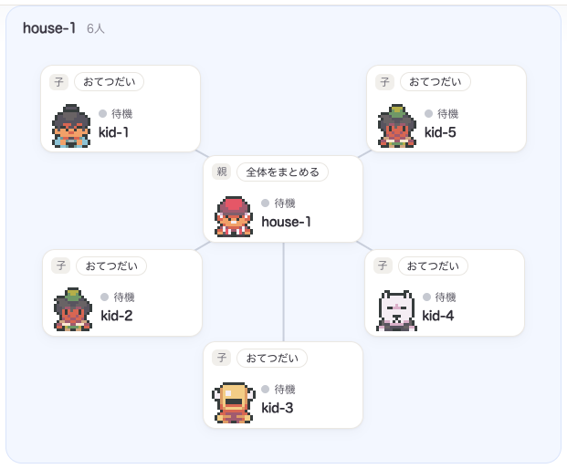
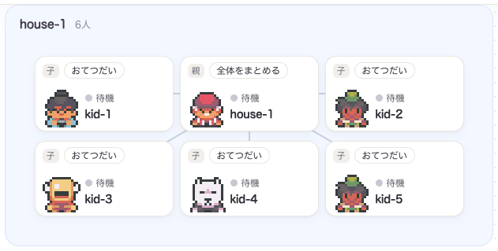
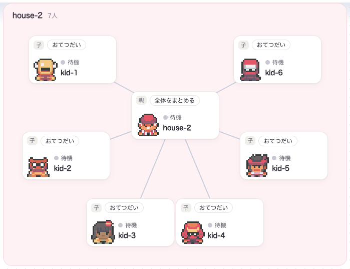
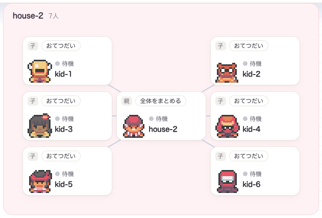
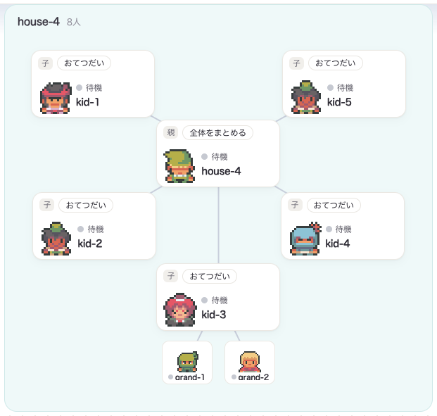
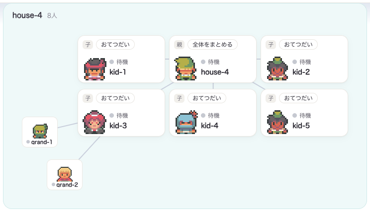
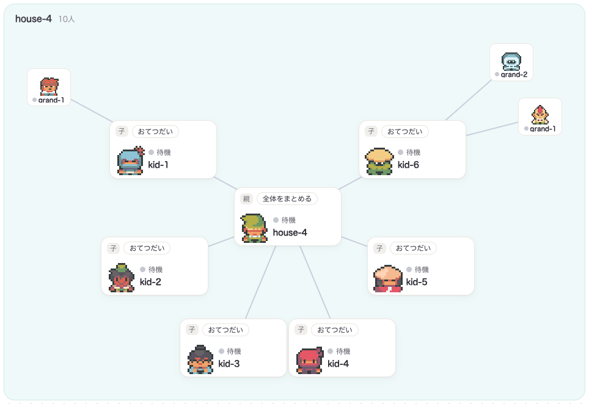
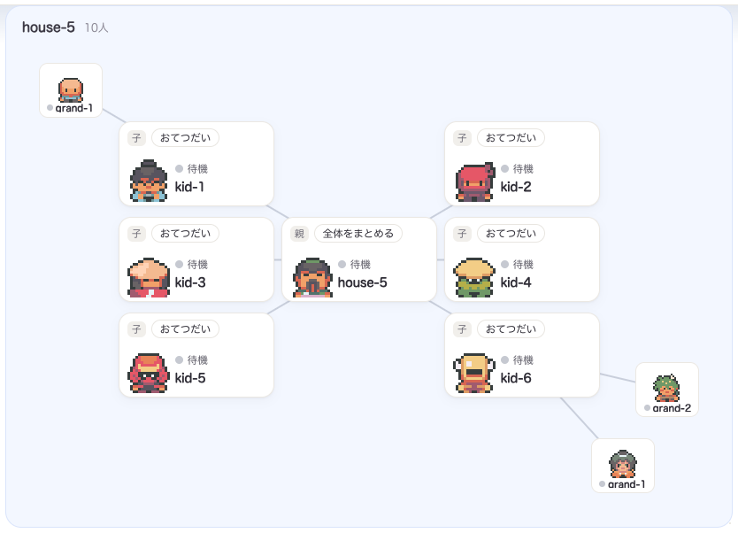

> 採否: 2026-11-12 にこちらを採った（本人の文のまま）。検証ケースなどは physics-layout.md の 10 を使う。

**書ける。今回の要件なら、力を毎フレーム計算せず、幾何学で座標を直接決められる。** さっきのプロンプトは物理シミュレーションとして実装を重くしすぎた。

「重力」「糸」「電子殻」を、それぞれ配置規則に置き換えればいい。

| 物理の表現 | 配置規則 |
|---|---|
| 下向きの重力 | 配置する角度の中心を下向きにする |
| 親子の糸 | 子を親の方向に近い位置へ置く |
| 兄弟の糸 | 重ならない最小間隔で兄弟を並べる |
| 電子殻 | 世代ごとの半径・半径範囲を決める |
| 衝突 | 図形の大きさから必要な間隔を計算する |
| 摩擦 | 再計算後の座標へ短いアニメーションで移動する |

例えば、**半径 \(r\) の子を、親から距離 \(R\) の円周上に並べる**なら、重ならない最小角度は、余白なしで、

\[
\Delta\theta=2\arcsin\left(\frac{r}{R}\right)
\]

親も同じ大きさで、親子が接する \(R=2r\) なら、これが60度になる。

下向きを0度として、子が \(n\) 人いるとき、各子の角度を

\[
\theta_i=\left(i-\frac{n-1}{2}\right)\Delta\theta
\qquad(i=0,\ldots,n-1)
\]

とすれば、

- **1人：0度。真下。**
- **2人：−30度、＋30度。**
- **3人：−60度、0度、＋60度。**

になる。**偶然の対称配置も、対称性を崩すノイズも、そもそも不要。** 一周に収まらなければ半径を広げる。

孫まで含める場合は、**子の人数だけでなく、その子孫が必要とする角度幅を下から計算する**。

1. 葉から順に、各枝が必要とする幅を計算する。
2. 兄弟の枝を、必要な幅だけ間隔を空けて並べる。
3. 根の直下では全体を下向きに寄せ、孫以降では親の角度付近へ割り当てる。
4. 世代の半径と角度から座標を算出する。
5. 実際の名前・キャラの重なりを検査し、決まった順序で間隔や半径を調整する。

兄弟の順序を生成順＋IDなどで固定すれば、同じ入力から同じ配置が得られる。

ただし、**「決定論的に配置できる」と「全条件で数学的な最小配置を一発で求められる」は別。** 後者までは保証しなくても、再現可能でコンパクトな配置は作れる。必要な反復も「揺らして収束を待つ」ではなく、間隔や半径の探索として書ける。

今回のプロンプトは、**「物理モデルを実装せよ」から「この物理的な直感を満たす、決定論的な配置アルゴリズムを実装せよ」へ変更するのが適切。**

## 町によって同じ世帯の形が変わった件（2026-11-13）

### 何が起きたか

2026-11-12 に、同じ世帯が町によって違う形で描かれた。世帯は、親 e8c798cd と、incertotech へ転出した子5人からなる。

- 親の町（konaito-pro）では、親が上に、子5人のゴーストが下に扇形に並んだ。世帯の枠は 878×580 px になった。
- 子の町（incertotech）では、親のゴーストを真ん中に置き、子5人が周りを囲んだ。世帯の枠は 609×502 px で、面積は親の町の 0.60 倍だった。

### 原因

配置の関数（`layoutFamily`）は、どちらの町でも同じ入力から同じ座標を返していた。ゴーストの箱は本物と同じ大きさ（`boxOf`）で描くので、入力も同じになる。

違いを作っていたのは、`App.tsx` が世帯ごとに前回選んだ候補（`prevArc`）を覚えて、次の計算に渡していたことだ。`layoutFamily` は、前回の候補が検査を通り、画面に収まる（s ≤ 1）あいだは、その候補を使い続けていた。

- 親の町では、子が1人ずつ増えるのを見ていた。子が1人のときは4つの候補の s が同じなので、最初の候補0（弧の上限 0.9π）が選ばれた。子が5人になっても s は 0.802 で 1 以下なので、候補0の扇形が残った。
- 子の町では、親のゴーストは別の町の一覧を読んで初めて現れる。そのときの根の ID は `ghost:e8c798cd` で、前回の候補が無い。そのため、子5人がそろった状態で選び直し、s が一番小さい候補3（弧の上限 1.9π、s 0.604）になった。本人が incertotech の町を開いたのは子がそろってからだと考えられるが、開いた時刻は確かめていない。

同じ顔ぶれでも、どの順で増えるのを見ていたかで形が変わっていた。

### 直し方

- 前回の候補の引き継ぎをやめた。`layoutFamily` から `prevArcIndex` を、`params.ts` から `keepMargin` を、`App.tsx` から `prevArc` を外した。同じ顔ぶれなら、どの町で、どの順で増えても同じ配置になる。
- 配置を計算し直すのは、これまでどおり顔ぶれ（id、親、名前、開始時刻）が変わったときだけにした。状態や会話が更新されても、キャラは動かない。
- 世帯の枠の外寸を出す式を `App.tsx` から `params.ts` の `groupSizeOf` に移し、試験から同じ式で枠の大きさを測れるようにした。
- `layoutFamily` が返す候補ごとの値に、幅と高さを足した。

引き継ぎは、子が増えたときに形が大きく変わらないように入れていた。外した後に、試験7の入力（子3人と孫3人の世帯に子を1人足す）で比べた。既にいた箱の最大の移動は、引き継ぐ場合が 197 px、引き継がない場合が 203 px で、ほとんど変わらなかった。追加後の大きさは、引き継ぐ場合が 785×507 px、引き継がない場合が 614×372 px だった。

親1人に子を1人ずつ5人まで足す場合も比べた。移動は、世帯の枠の左上からの座標で測った。

| 足した子 | 引き継ぐ場合 | 引き継がない場合 |
|---|---|---|
| 1→2人 | 候補0→0、89 px | 候補0→0、89 px |
| 2→3人 | 候補0→0、190 px | 候補0→1、87 px |
| 3→4人 | 候補0→0、105 px | 候補1→3、117 px |
| 4→5人 | 候補0→0、129 px | 候補3→3、202 px |

引き継がない場合は、3人から4人のあいだに扇形から親を囲む形に変わる。1回の追加で既にいた箱が動く距離の最大は、190 px から 202 px になった。

この直し方は、physics-layout.md の「子の追加・削除では現在位置を引き継ぎ」と食い違う。今回は、町によって形が変わらないことを優先した。試験7の、角度の順が保たれることと左右が反転しないことの検査は残している。

### 確かめたこと

- `src/layout/layout.test.ts` の試験9: 親が本物で子がゴーストの入力と、親がゴーストで子が本物の入力で、座標と選ぶ候補が一致する。
- 試験10: 子を1人ずつ5人まで増やした結果が、最初から5人いる結果と一致する。選ぶ候補は 0→0→1→3→3 と切り替わる。
- 試験11: 親1人と子5人の世帯の枠が、候補0では 878×580 px、選んだ候補3では 609×502 px になる。面積の比は 0.600 である。
- ブラウザ表示で、親の町を開いたまま子を1人ずつ5人まで増やした。直す前は扇形になり、スクショから読んだ枠の幅は約 877 px だった。直した後は、DOM の枠が 609×502 px になった。子の町は直す前も後も 609×502 px だった。

## 子1〜4人の固定の座標（2026-11-13）

### 決めたこと

親1人と子1〜4人だけの世帯は、弧の候補を計算せず、本人が決めた座標に子のカードを置く。座標は親のカードの中心を (0,0) とし、y は下を正にする。カードは 176×96 px で、カードどうしの最小の余白 m は `LAYOUT.cardMargin`（8 px）にした。

dx を (w+m)/2 の 92、dy を h+m の 104、side を w+m の 184 とする。

| 子の数 | 子の位置（兄弟の順） |
|---|---|
| 1人 | 真下 (0, 104) |
| 2人 | 左下 (-92, 104)、右下 (92, 104) |
| 3人 | 真上 (0, -104)、左下 (-92, 104)、右下 (92, 104) |
| 4人 | 左 (-184, 0)、右 (184, 0)、左下 (-92, 104)、右下 (92, 104) |

2枚のカードが重ならない条件は、中心の差が |xA-xB| ≥ w+m か |yA-yB| ≥ h+m を満たすことである。本人が決めた優先の順は、重ならない、余白 m を空ける、左右対称、親子の紐を短く、外接矩形を小さく、である。中心の間の距離をそろえることより、詰めることを優先する。

### 実装

- `src/layout/layout.ts` の `childSlots` が上の表を返す。`layoutFamily` は、孫がいない、子が1〜4人、全員がカードの大きさ、余白の指定が無い、のすべてを満たす世帯だけを固定の座標に置く。それ以外は前の節までの計算のまま使う。
- 子は兄弟の順（開始時刻、次に ID）に並べ、i 番目の子を表の i 番目の位置に置く。
- 固定の座標の結果も、これまでと同じ `measure` で重なり、交差、線が箱を通る数、幅と高さを出す。世帯の枠（`groupSizeOf`）と紐（親の中心から子の中心への線分）は、計算の場合と同じ式で描く。
- 固定の座標の結果は `arcIndex` を -1 にし、弧の候補（`candidates`）を空にする。

### 前の計算との違い

- 子が5人になると、固定の座標から弧の候補の計算に切り替わる。4人から5人に増えるときは形が大きく変わる。2026-11-21 からは、5人と6人も固定の座標に置く（次の節）。弧の計算に切り替わるのは7人からになった。
- 既存の余白 `LAYOUT.gap`（10 px）は前の計算で使い続ける。固定の座標だけが `cardMargin`（8 px）を使う。
- 前の節の試験10で選ぶ候補は、1〜4人では -1（固定の座標）になり、5人で候補3になる。2026-11-21 からは5人も -1 になる。試験9〜11は、余白を指定して弧の計算を呼び、候補0→0→1→3→3と枠の大きさの数字を残している。

### 確かめたこと

- `src/layout/layout.test.ts` の試験12で、子1〜4人の座標が表と一致する。親も含めた全てのカードの組が、上の重ならない条件を満たす。世帯の枠は、子1人で 251×303、2人で 435×303、3人で 435×407、4人で 619×303 px になる。
- 試験13で、子5人の世帯と孫のいる世帯は弧の候補の計算のままになる。ゴーストを含む世帯も、親の町と子の町で同じ座標になる。2026-11-21 からは、試験13は子7人の世帯と、子1〜4人で孫のいる世帯を見る。
- 開発版の画面（vite の 1420 を `?mock&mockport=<ポート>` で開き、`scripts/mock-ccn-town.ts --kids 1,2,3,4` の町を出した）で、子1〜4人の世帯を見た。4つの世帯とも `data-arc` が -1、`data-valid` が true だった。画面は `2026-11-13-child-layout-1to4.png` にある。

## 子5人と6人の格子（2026-11-21）

### 決めたこと

本人が、子5人と6人の世帯の並べ方を決めた（2026-11-21）。依頼の文は次のとおり。

> これさ、左１（真ん中親）右１、左下１、真ん中下１、右下１で配置した方がよくね。六の場合は、上２、左１（真ん中親）右１、下２の方が良いかも

それまでは弧の計算で置いていた。子5人は左上、右上、左下、右下、真下に並び、子6人は左右の子が親より下がっていた。

子5人と6人も、子1〜4人と同じく固定の座標に置く。左右の子は親と同じ高さに置く。上下の段の x は、左右の列（±side）か真ん中（0）にそろえる。座標の決め方は前の節と同じで、親の中心が (0,0)、y は下が正である。side は 184 で、段の間の距離 gy は 108 にした。

| 子の数 | 子の位置（兄弟の順） |
|---|---|
| 5人 | 左 (-184, 0)、右 (184, 0)、左下 (-184, 108)、真下 (0, 108)、右下 (184, 108) |
| 6人 | 左上 (-184, -108)、右上 (184, -108)、左 (-184, 0)、右 (184, 0)、左下 (-184, 108)、右下 (184, 108) |

兄弟の順は、1〜4人と同じく上の段から下の段へ、同じ段は左から右へ並べた。何番目の子がどこに来るかを、人数によらず同じ読み方で追えるようにするためである。

この順では、子が1人増えたときに既にいた子が動く。動いた距離をスロットの表から測った。

| 増えたとき | 既にいた子の動き（兄弟の順に） |
|---|---|
| 3→4人 | 1人目 211 px、2人目 295 px（左右が反転）、3人目 184 px（左右が反転） |
| 4→5人 | 1人目と2人目は動かない。3人目と4人目は 92 px |
| 5→6人 | 1〜3人目は 108 px、4人目は 213 px、5人目は 368 px（右下から左下へ反転） |

physics-layout.md の 10 は、子の追加で全体が反転しないことを条件にしている。1〜4人の座標の時点で、この条件は守れていない。5→6人の反転をなくすには、6人の順を「左、右、左下、左上、右下、右上」のように読み順から外す必要がある。今回は読み順を取った。

### 段の間を 108 px にした理由

1〜4人の段の間 h+m（104 px）を使うと、親から角の子への紐が、左右の子と真下の子の箱の角をかすめる。検査（`measure` の「線が箱を通る」）は箱を余白の半分（`LAYOUT.gap` の半分の 5 px）だけ膨らませて数えるので、104 px では5人と6人の配置が検査を通らない。

紐は親の中心 (0,0) から角の子の中心 (side, gy) への線分である。左右の子の箱の内側の縁は x = side-(w/2+5) にある。そこで紐の y が h/2+5 以上になる条件から、gy ≥ (h/2+5)·side/(side-w/2-5) = 53·184/91 ≒ 107.2 になる。真下の子の箱についても同じ値になる。h+m を下限にし、この値を切り上げた 108 px を使う。式は `src/layout/layout.ts` の `gridRowGap` にある。

### 孫がいる場合

子が5人か6人で孫がいる世帯は、子を上の表の位置に置いたうえで、孫より下をその子の外側に並べる（`placeGrid`）。

- 子 k の枝の世代ごとの半径は、根から子 k までの距離から始める。子 k の向きでの箱の半分の長さと `radialGap` を足して、次の世代の半径にする。箱の半分の長さは |w/2·sinθ|+|h/2·cosθ| で出す。左右の子なら w/2、真下の子なら h/2 になる。
- 兄弟は、子 k の角度（孫より下は親の角度）を中心に、重ならない最小の角度 2·arcsin(r/R) で並べる。必要な幅は葉から足し上げる。ここは弧の計算と同じ決まりである。
- 検査（重なり、親子線の交差、線が箱を通ること、枝の混ざり）に通らなければ、違反した枝の孫の半径を `radiusStep`（14 px）ずつ広げる。重なった組は深いほうの箱の枝を広げ、同じ深さなら両方の枝を広げる。重なりが無く線の検査だけが残るときは、孫のいる枝をすべて広げる。
- `maxAdjust`（40回）で通らなければ、弧の計算に戻す。戻したときは、格子の結果の検査の値を `layoutFamily` の結果の `fallback` に残し、`console.warn` で知らせる。画面では、世帯の `data-arc` が -1 でなく 0 以上になる。

子5人か6人で孫がいない世帯と、孫がいても格子に置けた世帯は、`arcIndex` が -1 になる。子1〜4人で孫がいる世帯と、子7人以上の世帯は、これまでどおり弧の計算で置く。

### 7人以上の案（未実装）

本人の指定は5人と6人だけなので、7人以上は弧の計算のままにした。5人と6人の形から続けるなら、次の案がある。

- 7人は、6人の形の下の段に真下の子を足す（上2、左右1ずつ、下3）。
- 8人は、さらに上の段に真上の子を足し、親の周りの8か所を埋める。
- 9人からは、外側にもう1周の列を足すか、弧の計算に切り替える。

### 確かめたこと

- `src/layout/layout.test.ts` の試験14で、子5人と6人の座標が表と一致する。左右の子の y が親と同じで、左の列と右の列の x がそろい、下の段（6人は上の段も）の y がそろう。どのカードの組も重ならず、検査を通る。世帯の枠は、5人で 619×307 px、6人で 619×415 px になる。弧の計算では、5人の枠は 609×502 px だった。
- 試験15で、孫のいる世帯を格子に置けることを見た。5人で左下の子に孫2人の世帯は、s が 0.657（弧の計算では 0.720）になった。6人で左上の子に孫1人、右下の子に孫2人の世帯は、s が 0.747（弧の計算では 0.877）になった。6人の上の段の2人に孫が2人ずついる世帯と、ひ孫のいる5人と6人の世帯も格子に置けた。どの世帯も、孫より下は根から見て親より遠く、親の向きから45度以内にある。
- 孫の付け方を変えて、格子と弧の計算の s を比べた（子1人だけに孫1〜5人、全員に孫1〜8人、1人目と2人目、1人目と3人目に孫3〜8人）。格子に置けた形の多くは、格子のほうが s が小さい。格子のほうが s が大きくなったのは次の形である。新しい決まりは足していない。

| 形 | 格子の s と枠 | 弧の計算の s と枠 |
|---|---|---|
| 5人、全員に孫4人（36回広げた） | 1.254、1330×704 | 1.039、788×790 |
| 5人、1人目と3人目に孫5人（28回広げた） | 1.140、1126×856 | 1.040、1091×790 |
| 5人、1人目と2人目に孫8人（29回広げた） | 1.394、1470×658 | 1.386、1461×1014 |
| 5人、2人目に孫1人 | 0.634、709×307 | 0.611、686×502 |
| 5人、2人目に孫2人 | 0.632、708×326 | 0.609、684×502 |

下の2つは、横幅が少し広いだけで、枠の面積は格子のほうが小さい。

- 弧の計算に戻ったのは、5人の全員に孫5人と8人、5人の1人目と3人目に孫8人、6人の全員に孫4人と5人と8人、6人の1人目と3人目に孫8人の形だった。
- 試験16で、子5人と6人の世帯の1人目と3人目の子に孫を8人ずつ付けると、格子では40回広げても検査を通らない。この世帯は弧の計算に戻り、`fallback` に理由が残る。
- 試験9と10で、子5人と6人の格子も、親の町と子の町で同じ座標になる。子を1人ずつ6人まで増やした結果は、最初から6人いる結果と一致する。
- ブラウザ版（vite を `?mock&mockport=<ポート>` で開き、`scripts/mock-ccn-town.ts --kids 5,6,5,6 --grand 3:3:2,4:1:1,4:6:2` の町を出した）で、変える前と後の世帯を撮った。後の4つの世帯は、どれも `data-arc` が -1、`data-valid` が true だった。

| 世帯 | 変える前 | 変えた後 |
|---|---|---|
| 子5人 |  |  |
| 子6人 |  |  |
| 子5人、左下の子に孫2人 |  |  |
| 子6人、左上の子に孫1人、右下の子に孫2人 |  |  |
